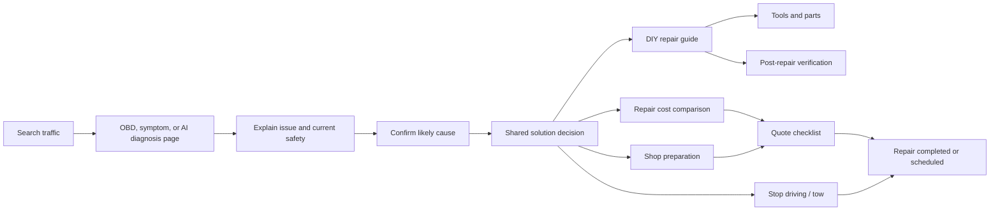
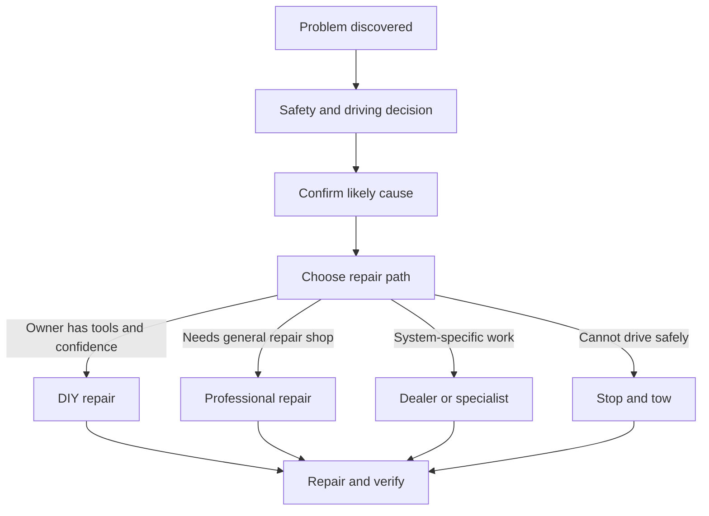
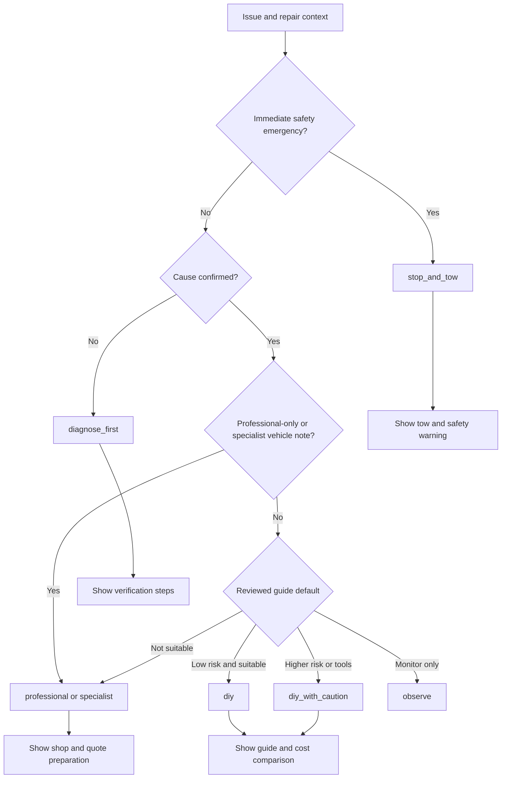
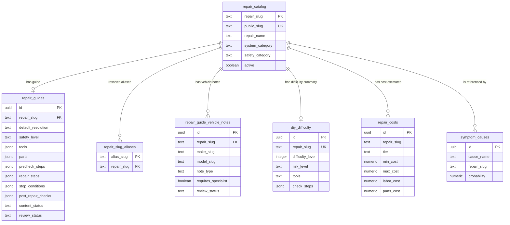
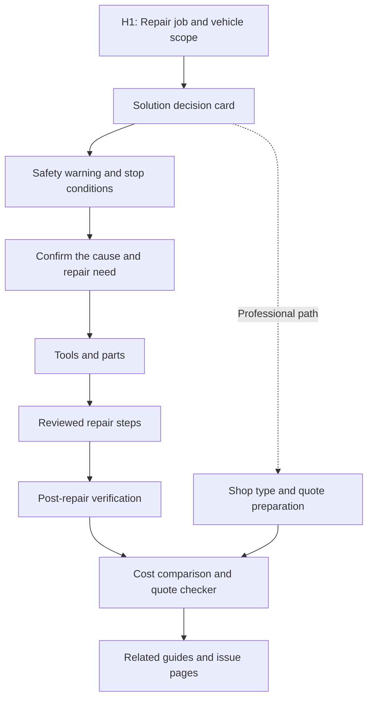
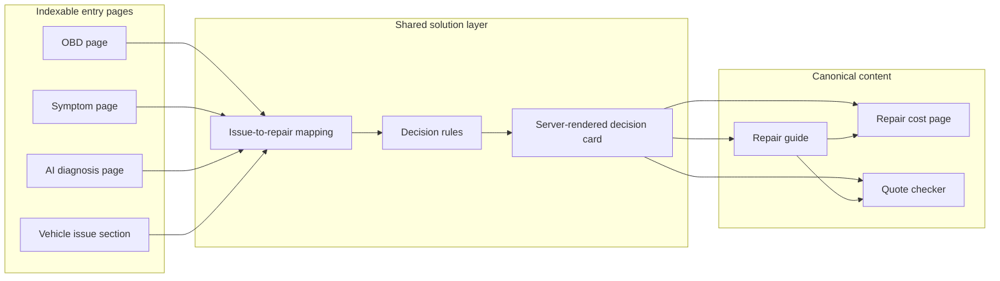
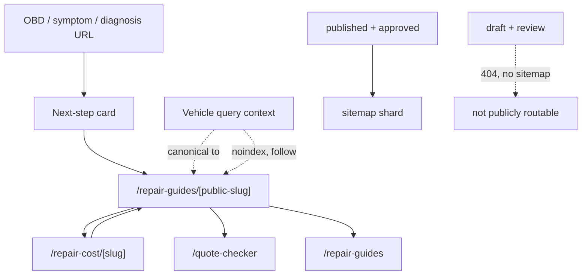
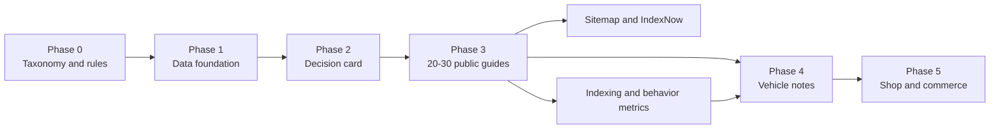

# AutOwner Solution Layer Design

- Date: 2026-11-18
- Status: Draft for product and engineering review
- Scope: Turn existing diagnosis pages into actionable repair decisions and repair guides

## 1. Summary

AutOwner currently explains what a problem may be, what it may cost, and whether it
is safe to drive. It does not consistently tell the user what to do next.

This design adds a shared Solution Layer to every indexable problem page. Instead
of writing unique long-form articles for every OBD code or AI diagnosis, all issue
pages map to a finite catalogue of standard repair jobs. Each repair job has one
canonical repair guide containing:

- a safe next-step decision;
- low-cost confirmation steps;
- DIY suitability;
- required tools and parts;
- repair steps and stop conditions;
- post-repair verification;
- shop type, questions to ask, and quote preparation.

The first release covers 20-30 high-value repair jobs. The architecture supports
later expansion without duplicating content across OBD, symptom, diagnosis, and
vehicle pages.

### 1.1 Architecture at a glance



## 2. Problem

The current product has useful fragments:

- OBD pages contain causes, verification checks, likely fixes, and cost ranges.
- Symptom pages contain causes, driving advice, diagnosis steps, and repair costs.
- AI diagnosis pages contain possible causes, verification steps, and a list of
  matched repair jobs.
- Repair cost pages contain labor and parts estimates and a basic DIY difficulty
  summary.

Those fragments do not form a complete user journey. A user still has to decide:

1. Is this safe to drive?
2. How do I confirm the cause without replacing parts blindly?
3. Can I realistically repair it myself?
4. What tools and parts do I need?
5. What are the repair steps and safety limits?
6. If I use a shop, what type of shop should I choose?
7. Is the quote reasonable?
8. How do I verify the repair afterward?

The answer is not to duplicate a tutorial on tens of thousands of generated pages.
The answer is to create a shared repair catalogue and connect every issue page to
the appropriate repair job.

## 3. Goals

- Give every indexable problem page a clear, data-backed next step.
- Help users distinguish DIY, inspection, general repair shop, specialist, and
  stop-driving scenarios.
- Reuse a small number of reviewed repair guides across many issue pages.
- Create a defensible content asset that improves search usefulness and trust.
- Add no per-request database amplification; content must be cached or statically
  rendered.
- Publish only complete, reviewed, indexable solution pages.
- Preserve existing repair-cost and quote-checker functionality.

## 4. Non-Goals

- Building a full repair-shop marketplace in the first release.
- Adding affiliate links to every tool or part before content quality is proven.
- Creating one guide for every OBD code or every AI-generated diagnosis.
- Publishing a guide for every repair slug on day one.
- Indexing arbitrary vehicle-specific query-string combinations.
- Allowing unreviewed AI output to publish directly.
- Replacing manufacturer service information, safety procedures, or professional
  inspection.
- Adding user accounts, maintenance history, or saved repair plans in the first
  release.

## 5. Product Principles

### 5.1 Safety before conversion

A safety warning must appear before any tool, part, shop, or affiliate action.
Critical issues must not be softened to increase engagement or monetization.

### 5.2 One repair job, one canonical guide

`battery`, `alternator`, and `brake_caliper` are repair jobs. A P0420 page, a
rough-idle symptom page, and an AI diagnosis are issue pages that may point to one
or more of those jobs.

### 5.3 Generic guide plus targeted vehicle overlays

The primary guide explains the common procedure and decision. Vehicle-specific
differences are stored as small overrides. AutOwner should not create one full
guide for every make/model/year combination.

### 5.4 Structured advice, not prose alone

Safety status, difficulty, tools, parts, stop conditions, shop type, and costs are
structured data. Prose supports those fields but does not replace them.

### 5.5 Publish less, publish better

Incomplete guides stay out of the sitemap and are not publicly routable. A repair
guide is published only after it passes the completeness and review gates.

### 5.6 Cache by default

Solution content is low-write and highly reusable. It should use static rendering
or long-lived data caches, not per-request Supabase queries.

## 6. User Journey

The shared journey is:



### 6.1 Entry points

The Solution Layer appears on:

- `/obd/[code]`
- `/symptoms/[slug]`
- `/symptom-checker/[slug]`
- vehicle pages when they list a specific issue or repair

The existing `/repair-cost/[slug]` page remains the cost and price-comparison page.
It links to the corresponding repair guide.

### 6.2 Issue page flow

1. Show the existing explanation and safety status.
2. Let the user confirm which cause matches their symptoms.
3. Once a cause is selected or confirmed, show a `Next Step` card for the mapped
   repair job.
4. Offer the appropriate action:
   - view the DIY guide;
   - compare repair costs;
   - prepare a shop quote;
   - stop driving and arrange a tow;
   - continue diagnosis when the cause is not confirmed.
5. If the user selects DIY, show the precheck, tools, parts, stop conditions, and
   repair steps.
6. If the user selects a shop path, show shop type, quote preparation, and
   questions to ask.

### 6.3 Decision card

The same server-rendered component is reused across issue page types. Its primary
content includes:

```text
Most likely repair: Battery replacement

Recommended path: DIY
Reason: Low risk, basic tools, and a short repair time.

Before replacing anything:
1. Check battery voltage.
2. Check terminal condition.
3. Confirm the charging system is working.

Typical shop cost: $180-$320
Estimated DIY parts: $120-$250
Tools: Basic hand tools
Estimated time: 10-15 minutes

[Open repair guide]
[Compare repair costs]
[Check a shop quote]
```

The reason and safety outcome must be present in the initial server-rendered HTML.
Interactive controls may enhance the card but must not be required to understand
the recommendation.

## 7. Decision Model

The displayed decision has two parts: a stable editorial default and runtime
safety overrides.

### 7.1 Resolution types

| Value | Meaning |
|---|---|
| `observe` | No immediate repair; monitor and define a return condition |
| `diagnose_first` | The cause is not confirmed enough to choose a repair |
| `diy` | Suitable for a typical owner with the listed tools |
| `diy_with_caution` | Possible for an experienced owner; risks or tool needs are higher |
| `professional` | Use a qualified repair shop |
| `specialist` | Use a dealer or system-specific specialist |
| `stop_and_tow` | Do not continue driving; stop safely and arrange recovery |

### 7.2 Precedence rules

The runtime applies rules in this order:

1. If the issue state indicates an immediate safety emergency, return
   `stop_and_tow`.
2. If the cause is not confirmed and the user has not selected a known repair,
   return `diagnose_first`.
3. If the guide is marked professional-only or the matching vehicle note requires
   a specialist, return `specialist` or `professional`.
4. If the repair is high-voltage, airbag/SRS, A/C refrigerant, timing-critical,
   ADAS calibration, hydraulic brake line, fuel leak, or spring-compression work,
   return `professional` or `specialist`.
5. Otherwise, use the guide's reviewed `default_resolution`.
6. If the default is `diy_with_caution` and the user has selected a vehicle with a
   restrictive note, upgrade the result to `professional`.

No cost-saving calculation may override a safety rule.



### 7.3 Cost comparison

The card may compare:

- typical shop cost from existing repair-cost data;
- estimated DIY parts cost;
- estimated required-tool cost;
- estimated net savings.

The comparison is informational. A repair does not become DIY merely because the
dollar saving is positive. Missing cost data is displayed as unavailable rather
than as zero.

Tool cost can change the wording:

- If the user marks the required tools as already owned, show parts-only savings.
- If tools must be purchased, show one-time tool investment separately.
- If tool investment consumes most of the first-repair saving, explain that the
  choice depends on expected future use and user confidence.

## 8. Data Architecture

### 8.1 Existing data

The current system already contains:

- `diy_difficulty`: 147 rows of difficulty, risk, tools, safety, and stage-based
  driving checks;
- `obd_diagnostic_steps`: diagnostic causes for 12,101 OBD codes;
- `symptom_causes`: 222 cause records linked to 77 repair slugs;
- `diagnoses.diagnosis_json.matchedRepairSlugs`: repair mappings from AI
  diagnoses;
- `repair_costs`: labor and parts estimates.

These remain source-of-truth for their current purposes.

`diy_difficulty.check_steps` describes progression from early warning to critical
driving risk. It is not a repair procedure and must not be presented as one.

### 8.2 Repair catalogue

Add a canonical repair catalogue before adding long-form guides:

```text
repair_catalog
  repair_slug       text primary key
  public_slug       text not null unique
  repair_name       text not null
  system_category   text not null
  safety_category   text not null
  active            boolean not null default true
  created_at        timestamptz not null default now()
  updated_at        timestamptz not null default now()
```

`repair_slug` is the canonical internal identifier used by existing data, such as
`battery`. `public_slug` is the stable URL identifier, such as
`battery-replacement`. Public URLs must resolve through `repair_catalog.public_slug`.

Suggested `system_category` values:

- engine
- fuel_and_air
- ignition
- emissions
- cooling
- electrical
- starting_and_charging
- brakes
- steering_and_suspension
- transmission_and_drivetrain
- body_and_interior
- climate_control
- safety_systems
- ev_high_voltage

Suggested `safety_category` values:

- normal
- elevated
- safety_critical
- professional_only

### 8.3 Repair slug aliases

Existing content contains naming variants such as different combinations of
underscores and suffixes. A canonical mapping table prevents issue pages from
pointing to semantically duplicated repairs:

```text
repair_slug_aliases
  alias_slug        text primary key
  repair_slug       text not null references repair_catalog(repair_slug)
  created_at        timestamptz not null default now()
```

The content pipeline normalizes every OBD, symptom, diagnosis, cost, and guide
reference through this table. A value that is already a canonical `repair_slug`
resolves directly without requiring an alias row.

### 8.4 Repair guides

The long-form guide is stored separately from the existing short-form difficulty
record:

```text
repair_guides
  id                     uuid primary key default gen_random_uuid()
  repair_slug            text not null unique references repair_catalog(repair_slug)
  title                  text not null
  summary                text not null
  default_resolution     text not null
  decision_reason        text not null
  safety_level           text not null
  safety_warning         text
  professional_only      boolean not null default false
  dealer_or_specialist   boolean not null default false
  estimated_parts_min    numeric
  estimated_parts_max    numeric
  estimated_tool_cost_min numeric
  estimated_tool_cost_max numeric
  tools                  jsonb not null default '[]'
  parts                  jsonb not null default '[]'
  precheck_steps         jsonb not null default '[]'
  repair_steps           jsonb not null default '[]'
  stop_conditions        jsonb not null default '[]'
  post_repair_checks     jsonb not null default '[]'
  shop_requirements      jsonb not null default '[]'
  quote_checklist        jsonb not null default '[]'
  vehicle_scope          text not null
  content_status         text not null default 'draft'
  review_status          text not null default 'draft'
  reviewed_by            text
  reviewed_at            timestamptz
  published_at           timestamptz
  sources                jsonb not null default '[]'
  created_at             timestamptz not null default now()
  updated_at             timestamptz not null default now()
```

Required JSON object shapes:

```text
tools:
  {
    "name": string,
    "requirement": "required" | "optional" | "rental",
    "estimated_cost": number | null,
    "note": string | null
  }

parts:
  {
    "name": string,
    "requirement": "required" | "inspect_first" | "optional",
    "estimated_cost_min": number | null,
    "estimated_cost_max": number | null,
    "note": string | null
  }

precheck_steps:
  {
    "order": number,
    "title": string,
    "instruction": string,
    "tools": string[],
    "pass_criteria": string,
    "fail_criteria": string
  }

repair_steps:
  {
    "order": number,
    "title": string,
    "instruction": string,
    "warning": string | null,
    "completion_check": string | null
  }

shop_requirements:
  {
    "shop_type": string,
    "reason": string,
    "questions": string[]
  }
```

The `content_status` values are:

- `draft`
- `in_review`
- `published`
- `archived`

The `review_status` values are:

- `draft`
- `technical_review`
- `approved`
- `rejected`

Only `content_status = published` and `review_status = approved` produce a public,
indexable guide.

### 8.5 Vehicle-specific notes

Vehicle differences use overrides rather than duplicated full guides:

```text
repair_guide_vehicle_notes
  id                 uuid primary key default gen_random_uuid()
  repair_slug        text not null references repair_catalog(repair_slug)
  make_slug          text not null
  model_slug         text
  year_start         integer
  year_end           integer
  note_type          text not null
  title              text not null
  content            text not null
  requires_specialist boolean not null default false
  sources            jsonb not null default '[]'
  review_status      text not null default 'draft'
  created_at         timestamptz not null default now()
  updated_at         timestamptz not null default now()
```

Suggested `note_type` values:

- `safety`
- `tool`
- `part`
- `procedure`
- `software_reset`
- `known_failure`
- `warranty_or_recall`

The first release displays these notes when a vehicle is already known from the
page context. It does not create indexable vehicle-specific URL variants.

### 8.6 Indexes

- Unique index on `repair_guides.repair_slug`.
- Index on `repair_guides(content_status, review_status)`.
- Index on `repair_guide_vehicle_notes(repair_slug, make_slug, model_slug)`.
- Index on `repair_slug_aliases(repair_slug)`.
- Existing `diy_difficulty`, `repair_costs`, `obd_diagnostic_steps`, and
  `symptom_causes` indexes remain unchanged.

### 8.7 Access control

- Enable RLS on all new tables.
- Anonymous users may read active catalogue rows and published, approved guides.
- Anonymous users may read vehicle notes only when `review_status = approved`.
- Anonymous users cannot write to catalogue, guide, alias, or vehicle-note tables.
- Content imports and publication updates use the service role from a trusted
  server-side process.
- Public page queries still filter on publication status in application code. RLS
  is a second boundary, not a replacement for explicit application checks.

### 8.8 Data relationships



## 9. Application Architecture

### 9.1 Server data layer

Add focused server functions:

```text
resolveRepairSlug(value)
getRepairGuideByPublicSlug(publicSlug)
getSolutionForRepair(repairSlug, issueContext)
getVehicleRepairNotes(repairSlug, makeSlug, modelSlug, year)
getPublishedRepairGuides(limit, page)
```

All functions:

- normalize internal slugs through aliases and validate public slugs against the
  catalogue;
- return `null` for missing or unpublished guides;
- throw on database errors so failures are not cached as empty content;
- use long-lived `unstable_cache` entries;
- do not issue an N+1 query from page components.

The guide page should need no more than:

1. one guide lookup;
2. one vehicle-note lookup when a vehicle is known;
3. one repair-cost lookup for comparison.

### 9.2 Rendering and caching

- `/repair-guides/[slug]` uses static generation with ISR.
- Revalidation is daily for the first release, with a 30-day stale retention.
- The index page uses ISR and does not query Supabase per request.
- The decision card is server-rendered.
- Tool ownership selection and interaction are client-side progressive
  enhancement.
- Publishing a guide must invalidate its path and the guide index.

If publishing is performed only through a deployment-time content import, the
deployment itself provides invalidation.

### 9.3 Components

Create three focused components:

1. `SolutionDecisionCard`
   - resolution, reason, safety, time, difficulty, cost summary, primary action.
2. `RepairGuideBody`
   - prechecks, tools, parts, steps, stop conditions, post-checks, sources.
3. `ShopPreparationCard`
   - shop type, quote checklist, questions, link to quote checker.

`ObdDiagnosticFunnel`, symptom-page cause cards, and AI-diagnosis cause cards should
eventually use `SolutionDecisionCard` rather than each implementing their own
repair links.





## 10. URL and SEO Design

### 10.1 URL structure

```text
/repair-guides
/repair-guides/[repair-slug]
```

Examples:

```text
/repair-guides/battery-replacement
/repair-guides/alternator-replacement
/repair-guides/brake-caliper-replacement
```

Existing URLs remain in place:

- `/repair-cost/[slug]`
- `/obd/[code]`
- `/symptoms/[slug]`
- `/symptom-checker/[slug]`

No separate vehicle-specific guide URL is published in the first release.
Vehicle context in a query string uses the generic guide as canonical and is
`noindex, follow`.



### 10.2 Internal linking

- Every published issue-to-repair mapping links to its guide.
- Every published guide links to the corresponding repair-cost page.
- Every published cost page links back to the guide.
- The guide links to quote checking only after safety and recommendation content.
- Related guides may be linked by repair category, not by arbitrary keyword
  matching.

### 10.3 Metadata

Each published guide has:

- a unique title describing the repair, DIY suitability, and vehicle applicability;
- a unique description based on the actual reviewed content;
- a self-referencing canonical URL;
- one visible H1 in the initial HTML;
- `Article` and `BreadcrumbList` structured data;
- no duplicate FAQ blocks generated from thin or unverified text.

No `HowTo` rich-result schema is required. The visible, reviewed procedure is the
primary product, and schema must not promise unsupported rich-result eligibility.

### 10.4 Indexing

- Draft, review, rejected, and archived guides are not publicly routable and
  return 404 if accessed directly.
- Published guides are added to a new sitemap shard.
- Sitemap shard generation throws on database errors rather than caching partial
  output.
- A published guide is submitted through IndexNow only after its deployment is
  live and its raw HTML has been verified.
- Unfinished guides are never included in the sitemap.

## 11. Content Production

### 11.1 Initial repair selection

Select the first 20-30 repair jobs using:

- sum of `obd_codes.view_count` for mapped OBD causes;
- sum of `diagnoses.view_count` for mapped diagnoses;
- existing search-query demand where available;
- coverage across common, useful repairs;
- a mix of DIY-friendly and professional-only cases so the decision logic is
  exercised.

The selection is stored as a reviewed allowlist. The application must not silently
create guide pages from every discovered repair slug.

### 11.2 Content workflow

1. Choose a repair job from the reviewed allowlist.
2. Normalize duplicates through `repair_slug_aliases`.
3. Generate a draft from structured internal data and permitted source material.
4. Fill every required field in the guide.
5. Validate safety categories and stop conditions.
6. Perform technical review.
7. Verify the rendered page, initial H1, canonical, and no unwanted noindex.
8. Publish and submit through IndexNow.

AI may draft content, but publication requires explicit review. The following
categories require a reviewer with relevant automotive experience before the
first publication:

- brakes and hydraulic systems;
- steering and suspension;
- airbag/SRS;
- high-voltage EV systems;
- fuel leaks and high-pressure fuel systems;
- A/C refrigerant;
- timing systems;
- ADAS/glass calibration.

### 11.3 Source and safety rules

- Do not reproduce copyrighted service-manual text.
- Do not invent torque specifications, fluid specifications, or diagnostic values.
- Exact specifications appear only when tied to a vehicle-specific source and a
  verified vehicle scope.
- Every guide must state what the user should stop doing and when to tow.
- Every guide must state whether the procedure is generic or vehicle-dependent.
- A missing tool or specification is shown as unknown, never fabricated.
- Safety-critical content must not be generated solely from another AI answer.

### 11.4 Publication gates

A guide is publishable only when:

- title, summary, decision reason, and vehicle scope exist;
- resolution and safety category are set;
- at least one precheck confirms whether the repair is appropriate;
- tools and parts distinguish required, optional, and inspect-first items;
- every repair step has a completion check;
- at least one stop condition exists;
- post-repair verification exists;
- shop requirements or quote checklist exists when professional service is
  possible;
- sources are recorded;
- technical review is approved;
- content-status validation passes.

Word count alone is not a publication criterion.

## 12. Analytics and Success Metrics

Use existing user-event tracking sparingly. Required events:

- `solution_card_view`
- `solution_guide_click`
- `solution_repair_cost_click`
- `solution_quote_checker_click`
- `solution_tool_check`
- `solution_shop_path_click`

Each event includes `repair_slug`, entry-page type, and decision type. Do not send
free-form user queries in event metadata.

Initial success metrics:

- 100% of published guides have valid HTTP 200 raw HTML and one server-rendered H1.
- 100% of published guides pass content validation and review gates.
- No unpublished guide appears in a sitemap.
- Solution-card click-through to either guide or quote preparation.
- Guide-to-cost and guide-to-quote transition rate.
- Organic impressions and clicks for guide URLs after indexing.
- Database query count and cache status remain within existing performance limits.

## 13. Error Handling

- A guide-query failure returns an error or retries according to the route policy;
  it must never be cached as "guide not found".
- A missing published guide returns 404.
- Missing vehicle notes fall back to the generic guide.
- Missing cost data hides the comparison rather than showing `$0`.
- A malformed structured field fails content validation and blocks publication.
- A decision-rule error fails closed to `professional` for safety-critical
  categories.
- The issue page must still render its existing diagnosis content if the guide
  service is unavailable.

## 14. Testing

### 14.1 Unit tests

Table-driven tests for decision precedence:

- critical issue overrides a DIY guide;
- unconfirmed cause returns `diagnose_first`;
- professional-only guide blocks DIY;
- vehicle note can upgrade the result;
- missing cost data does not change safety;
- missing guide data does not produce a false recommendation.

Tests for slug normalization and publication eligibility.

### 14.2 Data tests

- Every published guide references an active catalogue repair.
- Every published guide passes the completeness validator.
- Every OBD/symptom/diagnosis repair slug resolves through the alias table.
- No active mapping points to a draft guide as a public destination.
- All guide and vehicle-note JSON fields match the expected shape.

### 14.3 Integration tests

- Published guide returns 200, canonical, one H1, and an indexable robots state.
- Draft guide does not have a public route.
- Published guide appears in sitemap; draft guide does not.
- Issue pages show the correct decision card and link.
- Database failure is not cached as a valid guide or empty sitemap.

### 14.4 Production verification

Before enabling the sitemap entry:

1. Fetch raw HTML as Bingbot and Googlebot.
2. Verify HTTP status.
3. Verify H1 count.
4. Verify canonical.
5. Verify robots meta and `X-Robots-Tag`.
6. Verify the page is present in the intended sitemap shard.
7. Submit only after deployment is healthy.

## 15. Rollout



### Phase 0: Taxonomy and rule audit

- Deduplicate repair slugs and create the alias map.
- Define repair and safety categories.
- Define the first reviewed repair allowlist.
- Agree decision-rule precedence.

Exit criterion: every mapped repair resolves to one canonical repair identity.

### Phase 1: Data foundation

- Add catalogue, alias, guide, and vehicle-note tables.
- Add content validation.
- Add server data functions and caches.
- Import three pilot guides.

Exit criterion: pilot guides can be queried, validated, and rendered in a
non-public environment without per-request database amplification.

### Phase 2: Shared decision card

- Add `SolutionDecisionCard`.
- Integrate it into one OBD, one symptom, and one AI-diagnosis page.
- Add event tracking.

Exit criterion: each pilot page shows the same recommendation for the same repair,
and the existing page remains available if guide data is missing.

### Phase 3: First public guide release

- Publish 20-30 reviewed guides.
- Add the guide index and detail pages.
- Add internal links from repair-cost and issue pages.
- Add the sitemap shard and IndexNow workflow.

Exit criterion: all published pages pass raw-HTML SEO and content gates, remain
cacheable, and introduce no Supabase timeout regression.

### Phase 4: Vehicle overlays

- Add notes for the highest-traffic vehicle models.
- Test vehicle-context selection.
- Keep generic guide URLs canonical.

Exit criterion: vehicle notes change recommendations only when reviewed and never
create thin vehicle-by-repair pages.

### Phase 5: Shop and commerce integration

- Add shop preparation and quote checklist.
- Link the shop path to quote checking.
- Add tool and part purchasing paths only after user behavior validates demand.

Exit criterion: commerce actions appear after safety and solution content, and
their impact is measurable separately from organic landing-page performance.

## 16. Resolved Decisions

- The first release uses generic repair guides with optional vehicle notes.
- A canonical repair job is the unit of content, not an OBD code or AI diagnosis.
- The existing cost page and new guide page remain separate but cross-linked.
- Query-string vehicle context remains non-indexable in the first release.
- Incomplete guides are not published or included in sitemaps.
- The decision card is server-rendered.
- Existing `diy_difficulty.check_steps` is not treated as a repair procedure.
- Commercial actions do not precede safety and solution content.

## 17. Acceptance Criteria

The design is implemented successfully when:

- A user arriving from an OBD, symptom, or diagnosis page can reach a clear next
  step within one click.
- The system recommends DIY, caution, professional, specialist, diagnosis-first,
  observation, or stop-and-tow using reviewed rules.
- A repair guide provides prechecks, tools, parts, steps, stop conditions,
  post-checks, and shop preparation where relevant.
- The same repair guide can serve multiple issue pages without duplicated content.
- The first 20-30 guide pages are server-rendered, indexable, internally linked,
  included in the correct sitemap, and verified in production.
- Draft and incomplete guides remain outside search indexes and sitemaps.
- The new feature does not create a new per-request Supabase hotspot.
